# dotfiles

## Contents

- [Wallpapers](#wallpapers)
  - [Animals](#animals)
  - [Anime](#anime)
  - [City](#city)
  - [Landscapes](#landscapes)
  - [Nature](#nature)

## Wallpapers

### Animals

<table><tbody>
<tr>
<td width="50%" valign="top">
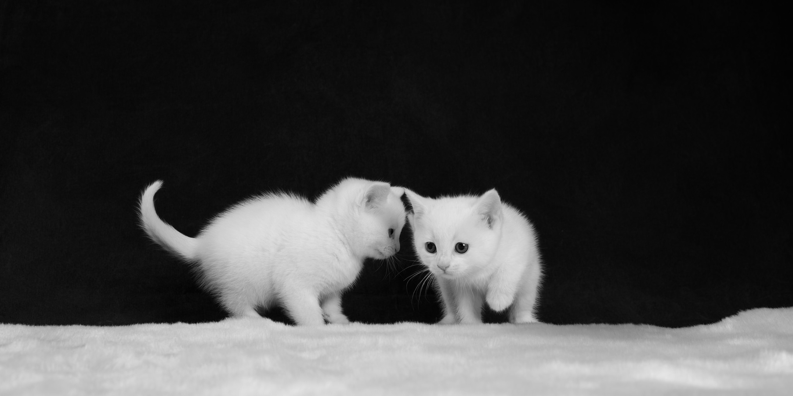

<strong>Kitties 1</strong> 
2160 × 1080 · FHD
</td>
<td width="50%"></td></tr>
</tbody></table>

### Anime

<table><tbody>
<tr>
<td width="50%" valign="top">
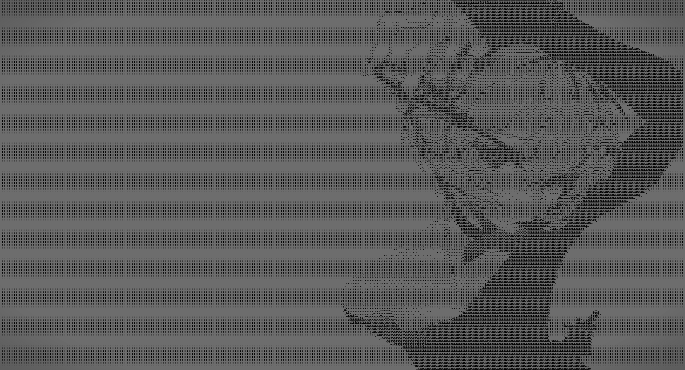

<strong>Anime Ascii 1</strong> 
2639 × 1429 · FHD
</td>
<td width="50%" valign="top">
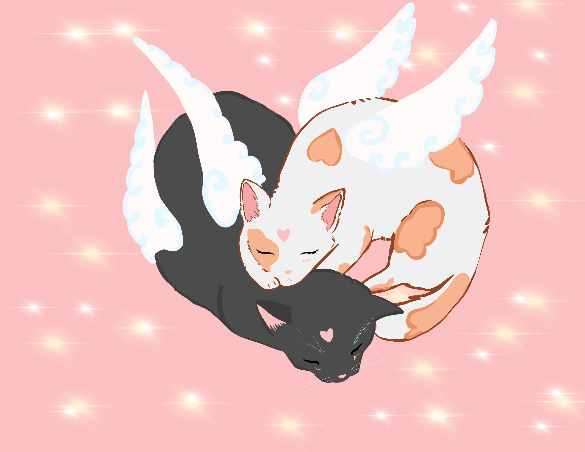

<strong>Cute Cats</strong> 
3300 × 2550 · 4K+
</td>
</tr>
<tr>
<td width="50%" valign="top">
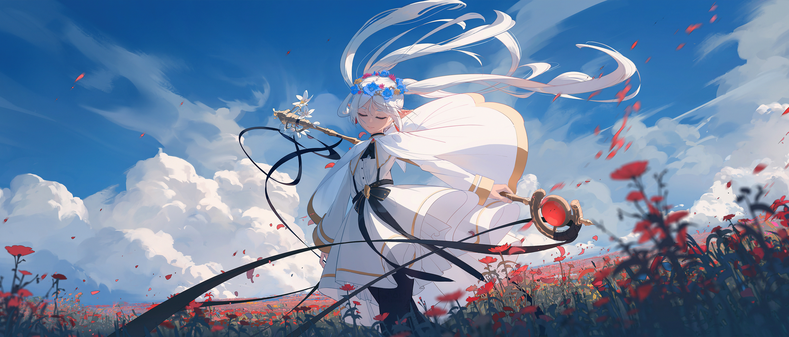

<strong>Frieren 1</strong> 
5040 × 2160 · 4K+ · UW
</td>
<td width="50%" valign="top">
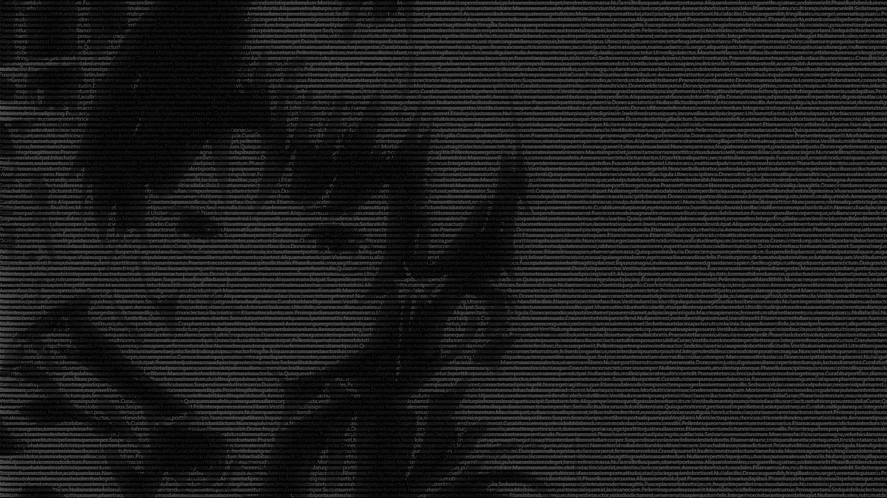

<strong>Lain 1</strong> 
1920 × 1080 · FHD
</td>
</tr>
<tr>
<td width="50%" valign="top">
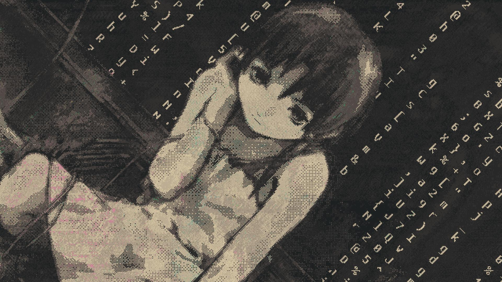

<strong>Lain 2</strong> 
1920 × 1080 · FHD
</td>
<td width="50%" valign="top">
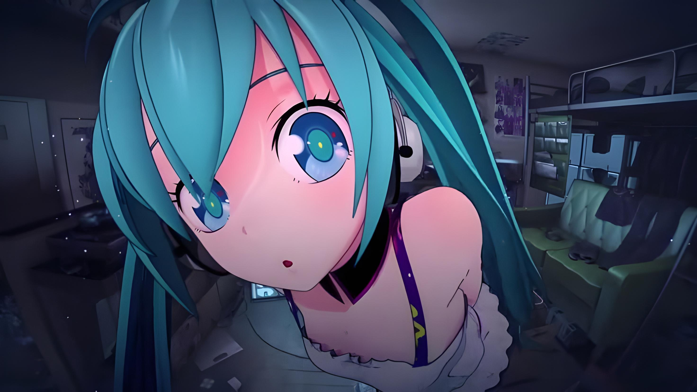

<strong>Miku 1</strong> 
2944 × 1656 · FHD
</td>
</tr>
<tr>
<td width="50%" valign="top">
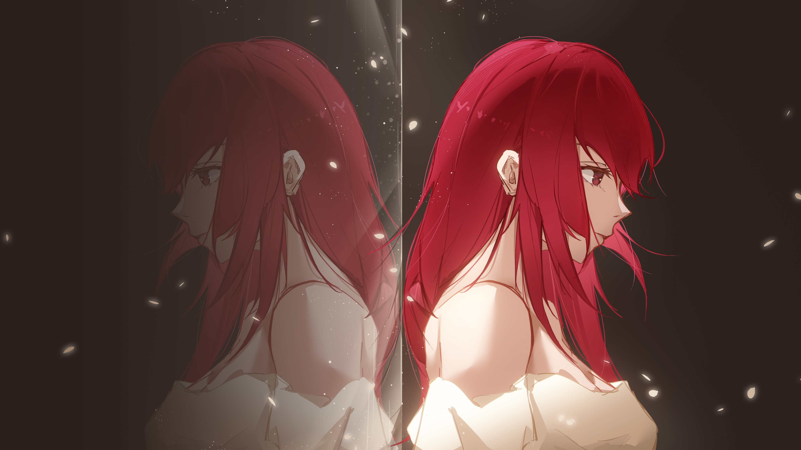

<strong>Red Hair Mirror</strong> 
4096 × 2304 · 4K+
</td>
<td width="50%" valign="top">
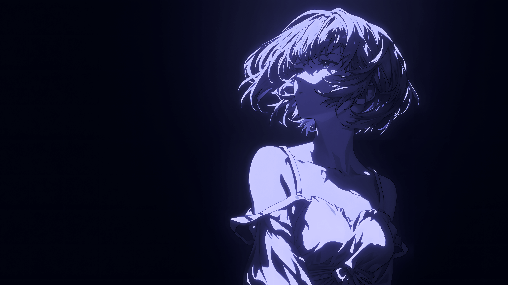

<strong>Rei 1</strong> 
3840 × 2160 · 4K+
</td>
</tr>
<tr>
<td width="50%" valign="top">
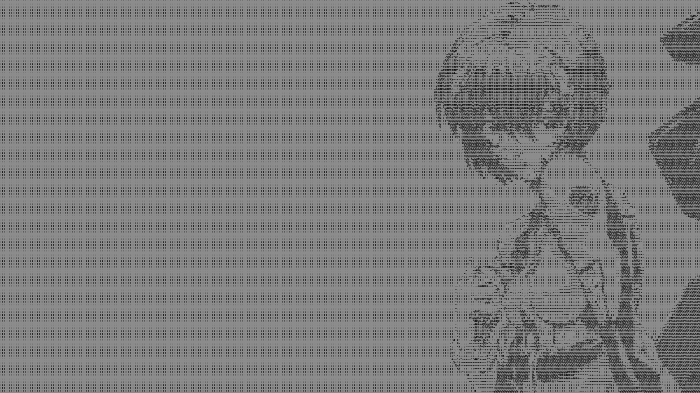

<strong>Rei 2</strong> 
2639 × 1484 · FHD
</td>
<td width="50%" valign="top">
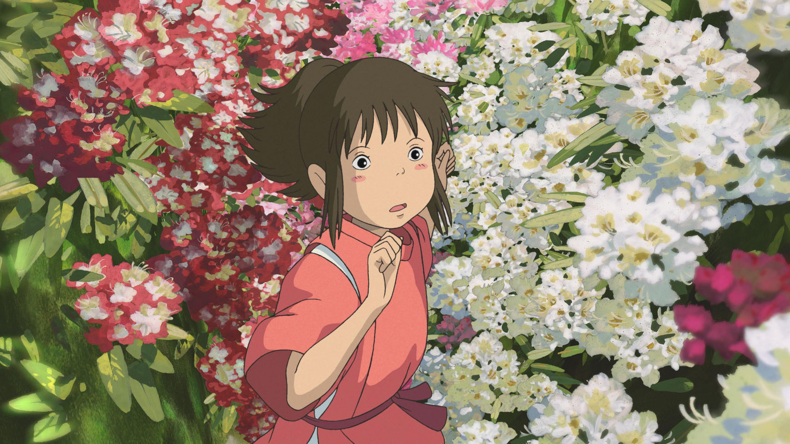

<strong>Spirited Away 1</strong> 
3840 × 2160 · 4K+
</td>
</tr>
<tr>
<td width="50%" valign="top">
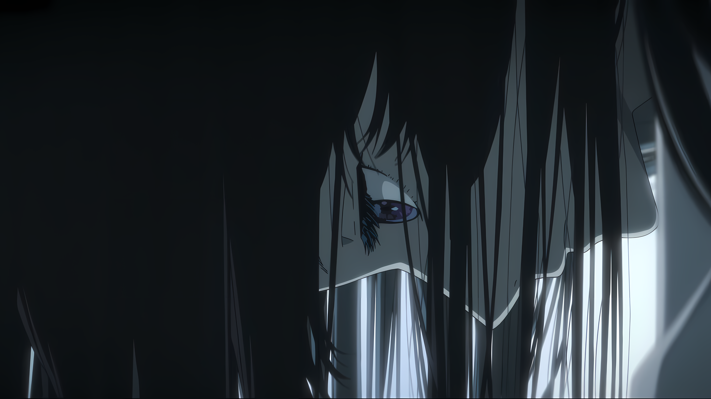

<strong>Tunnel Eye 1</strong> 
5716 × 3216 · 4K+
</td>
<td width="50%" valign="top">
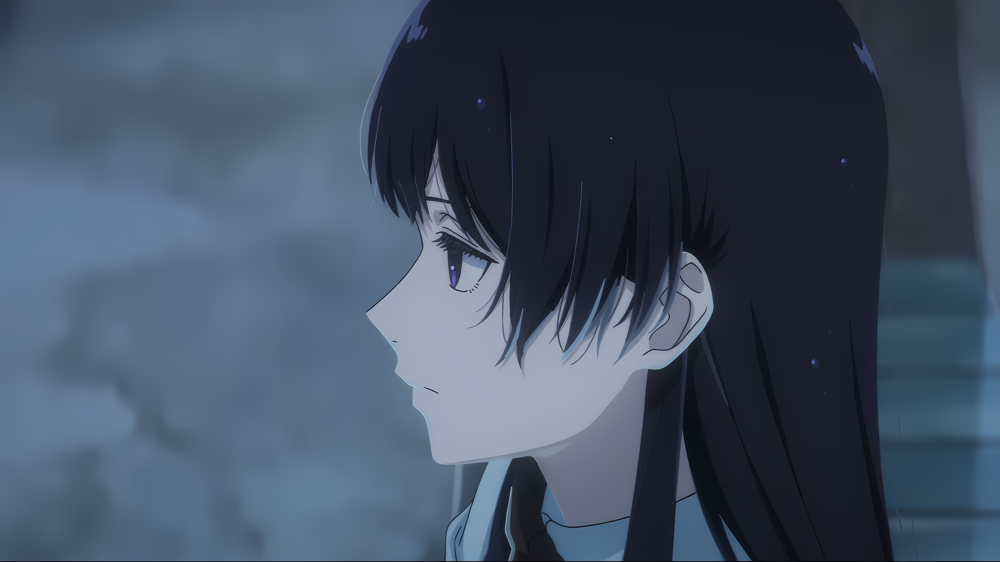

<strong>Tunnel Eye 2</strong> 
5716 × 3216 · 4K+
</td>
</tr>
<tr>
<td width="50%" valign="top">
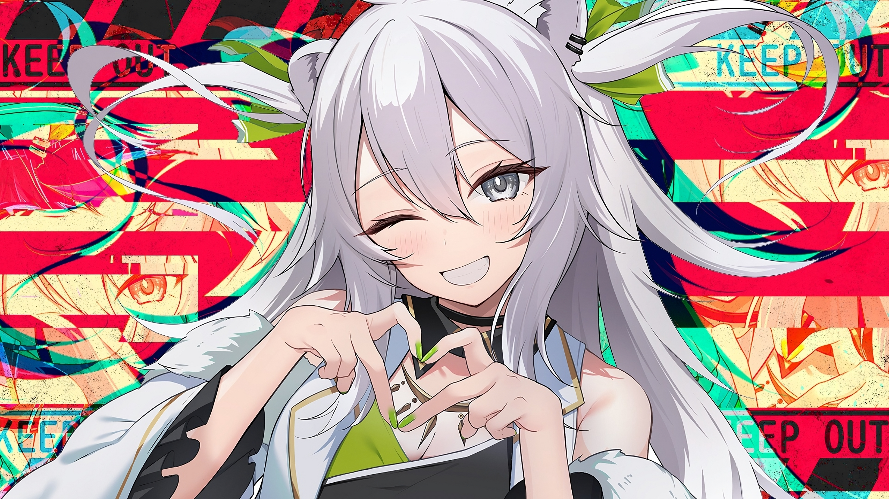

<strong>White Hair Keep Out</strong> 
3840 × 2160 · 4K+
</td>
<td width="50%"></td></tr>
</tbody></table>

### City

<table><tbody>
<tr>
<td width="50%" valign="top">
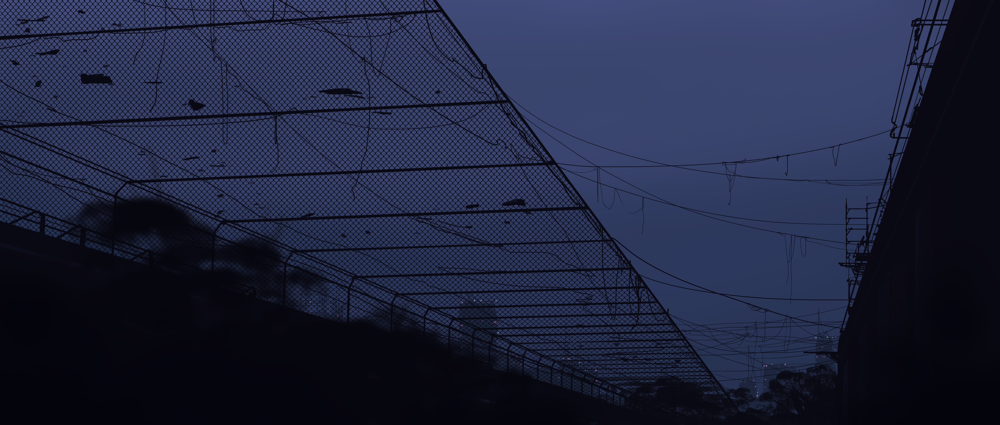

<strong>Kkfedsn</strong> 
5640 × 2400 · 4K+ · UW
</td>
<td width="50%"></td></tr>
</tbody></table>

### Landscapes

<table><tbody>
<tr>
<td width="50%" valign="top">
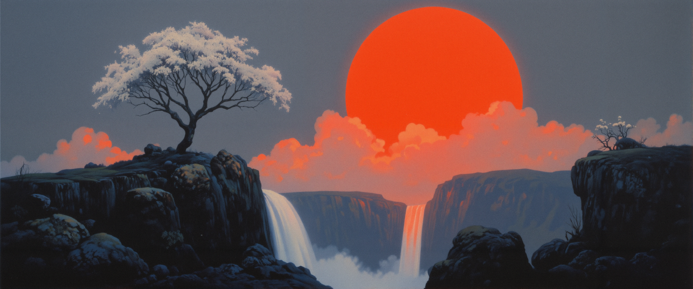

<strong>Red Sun Waterfall</strong> 
3648 × 1528 · FHD · UW
</td>
<td width="50%" valign="top">
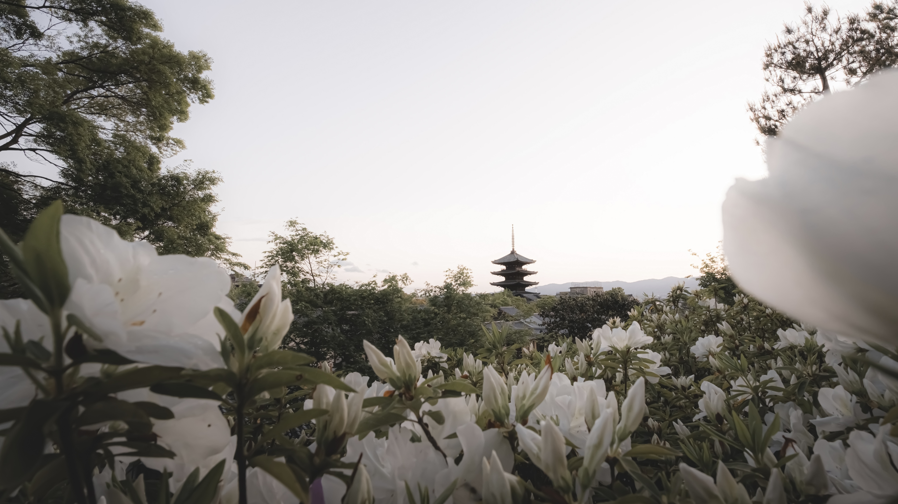

<strong>Ww</strong> 
3840 × 2160 · 4K+
</td>
</tr>
<tr>
</tr>
</tbody></table>

### Nature

<table><tbody>
<tr>
<td width="50%" valign="top">

<strong>Dried Flowers</strong> 
3840 × 2160 · 4K+
</td>
<td width="50%"></td></tr>
</tbody></table>

---

18 wallpapers · Automatically generated
